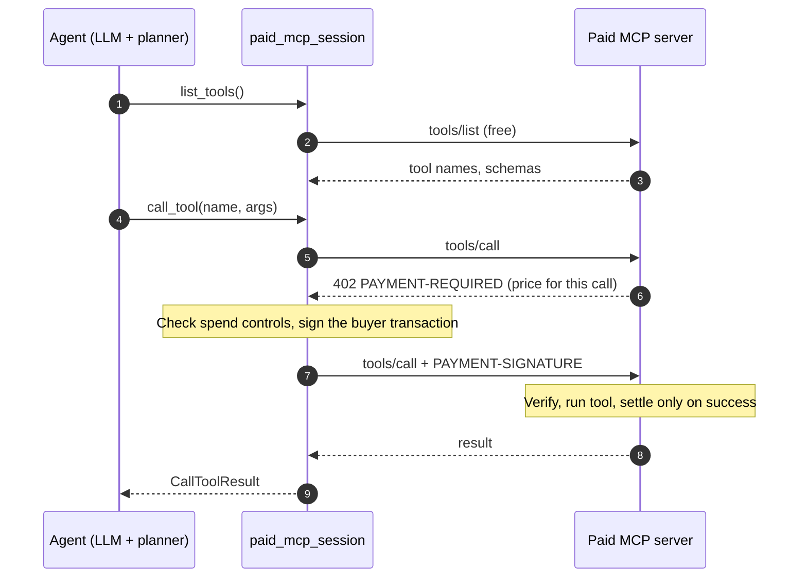

An agent built on the MCP Python SDK can use `paid_mcp_session` as its MCP client session. Tool discovery works as usual; each paid call is settled on Algorand without the agent's code handling payments.

## The loop



If the price is outside the spend controls, the session refuses to create the payment (`NoMatchingRequirementsError` in the x402 client) and nothing is signed.

## Minimal agent session

```python
import asyncio
import os

from ai_economy_sdk import paid_mcp_session

SERVER = "https://tools.example.com/sse"   # a paid MCP server

async def run_agent() -> None:
    async with paid_mcp_session(
        SERVER,
        os.environ["AGENT_PRIVATE_KEY"],   # base64 Algorand private key of a budget wallet
        "mainnet",
        spend_controls={"max_amount_per_payment": "$0.10"},  # tighter than the $1 default
    ) as session:
        tools = await session.list_tools()
        # Hand `tools.tools` to your model as callable tools; for each tool call it makes:
        result = await session.call_tool("summarize", {"text": "..."})
        if result.isError:
            # The tool failed: the payment was not settled. Decide whether to retry.
            ...
        print(result.content[0].text)

asyncio.run(run_agent())
```

The session object is an `mcp.ClientSession`, so it plugs into agent frameworks that accept an MCP session. Payments are invisible to the framework.

## What the agent pays for

| Event | Charged? |
|---|---|
| Opening the session, listing tools | No |
| A tool call priced 0, or covered by a pass | No |
| A paid tool call that succeeds | Yes, exactly the quoted price |
| A paid tool call whose tool raises or returns `isError` | No |
| A paid call whose settlement fails (`ToolError: payment settlement failed`) | No |
| The network fee | No: the server's fee payer pays it |
| Resending the same signed payment | Rejected with `402` (`Replay detected`), not charged twice |

## Identity

By default (`identity=True`) the session signs identity headers on every request, so servers know the agent's address. This is what lets a server apply a [pass](/ai-economy-sdk/passes) the agent bought, a subscription, a bulk discount or a per-caller price. The headers prove control of the address; they reveal nothing else and move no funds. Set `identity=False` if the agent should stay anonymous; it then pays the standard price.

## Networks

Use `"testnet"` with free TestNet ALGO while developing an agent, and switch to `"mainnet"` when it is ready. The session uses AlgoNode's public algod for MainNet and TestNet unless you pass `algod_url`. See [TestNet](/guides/networks/testnet).

## JavaScript agents

`x402-avm-js` has no MCP session wrapper. A Node agent that calls x402 HTTP APIs can use `decodePaymentRequired` and `payForRequirement`, and should apply its own limits before signing; see [Guardrails](/agents/guardrails#javascript-clients).

## Next steps

- [Discovering prices](/agents/discovering-prices)
- [Guardrails](/agents/guardrails)
