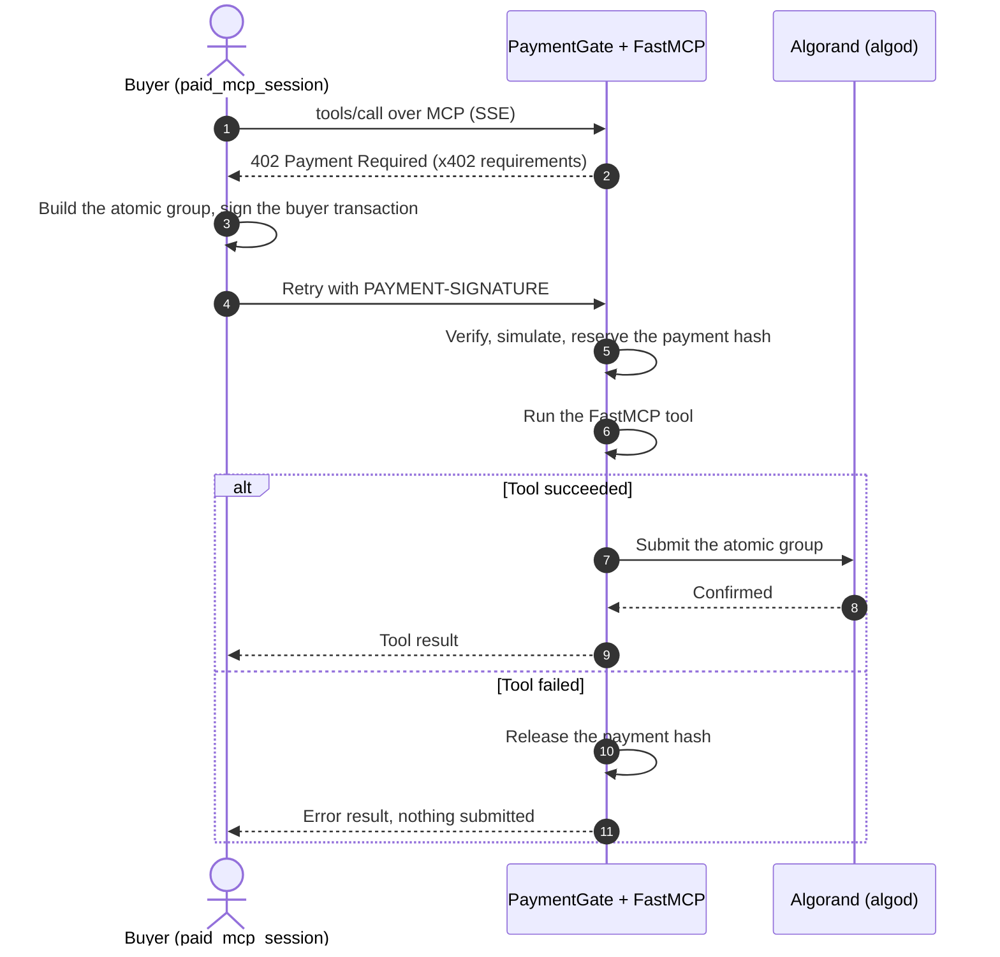

`ai-economy-sdk` (PyPI, MIT, version 0.4.0) adds per-call payments to [Model Context Protocol](https://modelcontextprotocol.io) servers built with FastMCP, and gives Python clients and agents a session that pays for tool calls automatically.

```bash
pip install ai-economy-sdk==0.4.0
```

## What it provides

| Feature | API |
|---|---|
| Gate an MCP server's tools behind x402 payments | [`PaymentGate`](/ai-economy-sdk/server), or the decorator-based [`AIEconomySDK`](/ai-economy-sdk/server#decorator-based-setup-with-aieconomysdk) |
| Call paid tools from Python, with spend limits | [`paid_mcp_session`](/ai-economy-sdk/client) |
| Fixed, per-tool, dynamic and bulk-discount prices | [Pricing](/ai-economy-sdk/pricing) |
| Prepaid passes and subscription tokens | [Passes](/ai-economy-sdk/passes) |
| Prove a caller's address without paying | [Identity](/ai-economy-sdk/identity) |
| Charge only when the tool succeeds; reject replayed payments | [Settlement](/ai-economy-sdk/settlement) |
| MainNet, TestNet, LocalNet and private networks | [`resolve_network`](/reference/python/ai-economy-sdk/resolve-network) and the other [network helpers](/networks) |

The server acts as the fee payer: it pays the 2,000 microALGO of fees for each two-transaction payment group, so buyers pay exactly the price.

## Architecture



`gate.wrap(mcp)` returns an ASGI application with two layers:

- **`GateMiddleware`** (Starlette): leaves `GET /sse` open, inspects `POST /messages*` requests, prices `tools/call` requests and answers `402` when payment is due.
- **`SettleOnSuccessMiddleware`** (FastMCP): runs the tool first and settles the payment only if the tool completes without error.

## Minimal example

<CodeGroup>
```python server.py
from fastmcp import FastMCP
from ai_economy_sdk import DefaultAvmSigner, PaymentGate

mcp = FastMCP("Forecast")

@mcp.tool()
def get_forecast(city: str) -> str:
    return f"Forecast for {city}: sunny, 22C"

gate = PaymentGate(
    signer=DefaultAvmSigner(server_sk, algod_client=algod_client),
    network="localnet",
    pay_to=server_addr,
    default_price=5_000,  # microALGO per call
)
app = gate.wrap(mcp)
```

```python client.py
import asyncio
from ai_economy_sdk import paid_mcp_session

async def main():
    async with paid_mcp_session("http://127.0.0.1:8000/sse", buyer_sk, "localnet") as session:
        result = await session.call_tool("get_forecast", {"city": "London"})
        print(result.content[0].text)

asyncio.run(main())
```
</CodeGroup>

The [Quickstart](/quickstart) runs this end to end on LocalNet.

## Migrating from 0.3

- Network ids are CAIP-2 short ids (`algorand:` plus 32 characters), for example `algorand:wGHE2Pwdvd7S12BL5FaOP20EGYesN73k`. Legacy 44-character ids are still accepted everywhere and converted.
- `x402-algorand` is now a plugin for the official `x402` package (2.28 or later) instead of a fork of it.

## Guides

<Columns cols={2}>
  <Card title="Server" icon="server" href="/ai-economy-sdk/server">Configure `PaymentGate` and serve it.</Card>
  <Card title="Client" icon="plug" href="/ai-economy-sdk/client">Call paid tools with `paid_mcp_session`.</Card>
  <Card title="Pricing" icon="tag" href="/ai-economy-sdk/pricing">Per-tool, dynamic and bulk prices; the fee floor.</Card>
  <Card title="Passes" icon="ticket" href="/ai-economy-sdk/passes">Prepaid access for a period.</Card>
  <Card title="Identity" icon="fingerprint" href="/ai-economy-sdk/identity">Prove a caller's address.</Card>
  <Card title="Settlement" icon="shield-check" href="/ai-economy-sdk/settlement">Settle-on-success and replay protection.</Card>
  <Card title="Production" icon="factory" href="/ai-economy-sdk/production">Keys, USDC, fee funding, workers, monitoring.</Card>
  <Card title="API reference" icon="book-open" href="/reference/python/ai-economy-sdk/index">Every public object.</Card>
</Columns>
