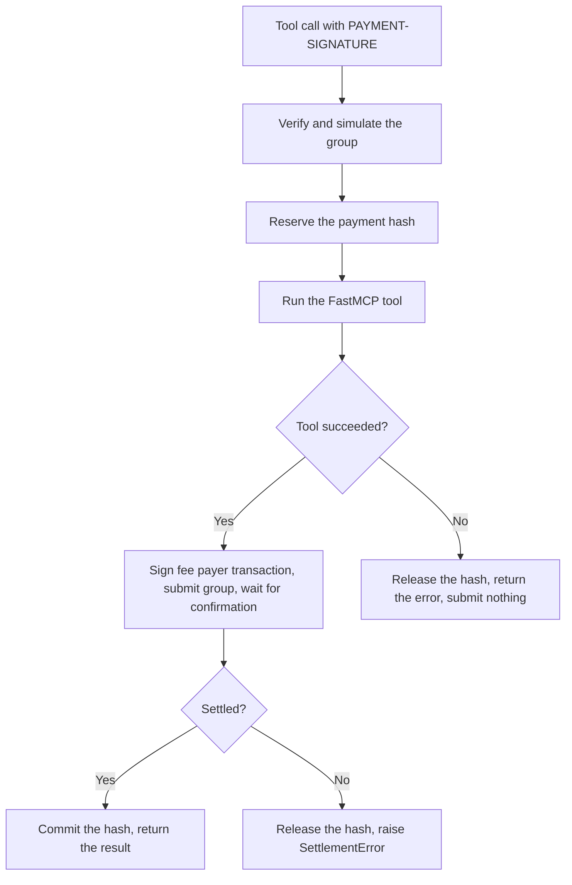

## Settle-on-success

`PaymentGate` verifies a payment before the tool runs, but submits it to the chain only after the tool has succeeded.



1. **Verify.** The facilitator checks the group against the requirement and simulates it on algod. Nothing is broadcast.
2. **Reserve.** The payment's hash is reserved in the replay store.
3. **Run.** `SettleOnSuccessMiddleware` runs the tool.
4. **Settle or discard.**
   - The tool succeeded (no exception, no `isError` result): the group is submitted, the hash is committed and the result is returned.
   - The tool failed: the reservation is released and the error is returned. The signed group is dropped, so the buyer is not charged.
   - Settlement failed (for example, the transactions expired or the fee payer is out of ALGO): the reservation is released and the client receives `SettlementError("payment settlement failed: <reason>")` instead of the tool result.

A reservation that is never settled or released is released after 300 seconds.

## Example: a failed call is not charged

The server on port 9204 has a tool that always raises. The buyer calls it and its balance does not change.

{/* example: localnet/failed_call_not_charged.py */}

```python localnet/failed_call_not_charged.py expandable
"""Settle-on-success guarantee: failed tool calls are never charged on-chain.

Starts an in-process FastMCP server on port 9204 with a tool that raises an exception.
A buyer calls the tool via paid_mcp_session and receives an error result, but
PaymentGate intercepts the failure and does not submit the signed payment to the
network. The buyer balance remains completely unchanged.

How to run:
    python localnet/failed_call_not_charged.py

What it prints:
    Tool call returned (isError=True): ...
    Balance drop: 0 microALGO
"""
import asyncio
import socket
import sys
import threading
import time
from pathlib import Path

sys.path.insert(0, str(Path(__file__).resolve().parent))

import uvicorn
from fastmcp import FastMCP
from ai_economy_sdk import DefaultAvmSigner, PaymentGate, paid_mcp_session
from _localnet import ALGOD, new_funded_account

SERVER_PORT = 9204
SERVER_URL = f"http://127.0.0.1:{SERVER_PORT}/mcp"
PRICE = 5000


def main() -> None:
    server_sk, server_addr = new_funded_account(algos=10)
    buyer_sk, buyer_addr = new_funded_account(algos=10)

    mcp = FastMCP("FailServer")

    @mcp.tool()
    def fail_tool(reason: str) -> str:
        """Simulate a tool raising an unexpected error."""
        raise RuntimeError(f"Deliberate tool failure: {reason}")

    gate = PaymentGate(
        signer=DefaultAvmSigner(server_sk, algod_client=ALGOD),
        network="localnet",
        pay_to=server_addr,
        asset_id=0,
        prices={"fail_tool": PRICE},
    )

    app = gate.wrap(mcp, transport="streamable-http")
    server = uvicorn.Server(uvicorn.Config(app, host="127.0.0.1", port=SERVER_PORT, log_level="error"))
    server_thread = threading.Thread(target=server.run, daemon=True)
    server_thread.start()

    for _ in range(50):
        try:
            socket.create_connection(("127.0.0.1", SERVER_PORT), 0.2).close()
            break
        except OSError:
            time.sleep(0.1)

    async def execute_failing_call() -> None:
        b_before = ALGOD.account_info(buyer_addr)["amount"]

        async with paid_mcp_session(SERVER_URL, buyer_sk, "localnet") as session:
            result = await session.call_tool("fail_tool", {"reason": "computation error"})
            is_err = getattr(result, "isError", False)
            err_msg = result.content[0].text if result.content else "no content"
            print(f"Tool call returned (isError={is_err}): {err_msg}")

        b_after = ALGOD.account_info(buyer_addr)["amount"]
        drop = b_before - b_after
        print(f"Balance drop: {drop} microALGO")

    try:
        asyncio.run(execute_failing_call())
    finally:
        server.should_exit = True
        server_thread.join(timeout=5)


if __name__ == "__main__":
    main()
```

<sub>Source: [examples/localnet/failed_call_not_charged.py](https://github.com/x402-avm/examples/blob/main/localnet/failed_call_not_charged.py)</sub>

{/* /example */}

```bash
python localnet/failed_call_not_charged.py
```

```text
Tool call returned (isError=True): Error calling tool 'fail_tool': Deliberate tool failure: computation error
Balance drop: 0 microALGO
```

## Replay protection

A signed payment must buy exactly one call. The gate computes the SHA-256 hash of the payment payload and tracks it in a `ReplayStore`:

| Operation | When | Effect |
|---|---|---|
| `reserve(hash)` | After verification, before the tool runs | Inserts the hash as reserved. Returns `False` if the hash is already reserved or settled, and the request is rejected with `402` and `{"error": "Replay detected"}`. |
| `commit(hash)` | After settlement succeeds | Marks the hash settled. |
| `release(hash)` | After a tool failure or a settlement failure | Deletes the reservation, so the buyer can pay again. |

### Storage

- **In memory** (`replay_db=None`, the default): a dictionary guarded by a lock. Protects one process.
- **SQLite** (`replay_db="/path/replay.db"`): a database in WAL mode (`PRAGMA journal_mode=WAL;`). `reserve` is an `INSERT` on the primary key, so it is atomic across processes. Use it whenever more than one process serves the same `pay_to`, for example `uvicorn --workers 4`.

```python
gate = PaymentGate(
    signer=signer,
    network="mainnet",
    pay_to=server_address,
    asset_id=0,
    prices={"echo": 5000},
    replay_db="/var/data/replay.db",  # shared by every worker
)
```

The chain itself also rejects a group that was already confirmed, but the replay store stops a duplicate before the tool runs, which is what protects the service.

## Next steps

- [Production](/ai-economy-sdk/production)
- [Security](/resources/security)
