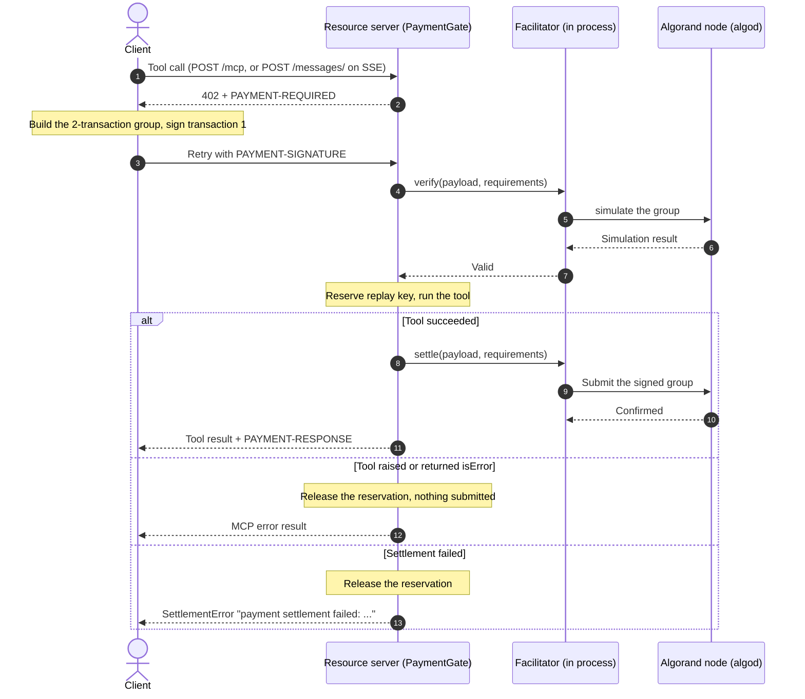

Read this page once and the rest of the docs will make sense: every Build page assumes the flow below and links back here instead of repeating it.

## The x402 flow

[x402](https://www.x402.org) sells a resource per request with HTTP status `402 Payment Required`. For an MCP server wrapped with `PaymentGate`, a tool call goes like this:

1. The client sends a JSON-RPC `tools/call`: `POST /mcp` on the Streamable HTTP transport, or `POST /messages/?session_id=...` after `GET /sse` on the legacy SSE transport. Connecting, initializing and listing tools are free.
2. The gate prices the call (tool, arguments, caller) and answers `402` with a `PAYMENT-REQUIRED` header: scheme, network, asset, amount, recipient (`payTo`) and fee payer.
3. The client builds and signs a payment that matches.
4. The client retries with the signed transactions in a `PAYMENT-SIGNATURE` header.
5. The server verifies the payment, reserves it against replay, runs the tool, settles on chain if the tool succeeded, and returns the result with a `PAYMENT-RESPONSE` header.

A call priced at 0 (free, or covered by a [pass](#passes)) goes straight through. HTTP APIs protected with `x402-algorand` follow the same steps for an ordinary request. Every header, decoded field by field: [HTTP 402 reference](/reference/protocol/http-402).



The facilitator is the part that verifies and settles. `PaymentGate` runs one in the same process (an `x402Facilitator` with the Algorand scheme and your signer). With `x402-algorand` you can also [run it separately](/build/facilitator).

## The two-transaction atomic group

When the server sponsors fees (it advertises `extra.feePayer`, which `PaymentGate` always does), the payment is an [atomic group](/resources/glossary#atomic-group) of two transactions, as the official [Algorand exact scheme](https://github.com/x402-foundation/x402/blob/main/specs/schemes/exact/scheme_exact_algo.md) specifies:

| Index | Type | Sender | Receiver | Amount | Fee | Signed by |
|---|---|---|---|---|---|---|
| 0 | `pay` | Fee payer | Fee payer | 0 | 2,000 microALGO | Server (fee payer), at settlement |
| 1 | `pay` (ALGO) or `axfer` (ASA) | Buyer | `payTo` | The price | 0 | Buyer |

Algorand pools fees within a group. The minimum is 1,000 microALGO per transaction, so transaction 0 pays 2,000 for both and transaction 1 pays nothing. The buyer's balance drops by exactly the price, even in USDC, because network fees are always paid in ALGO and the fee payer pays them.

The buyer signs only transaction 1. Because the group is atomic, the server cannot submit its fee transaction without the buyer's payment, and the payment cannot go through without the fee transaction.

Without a fee payer, the payment is one transaction signed by the buyer, who pays the normal 1,000 microALGO fee.

ALGO prices must cover the 2,000 microALGO the server pays per call; `PaymentGate` enforces a [fee floor](/build/pricing#the-fee-floor).

## Settle-on-success

Most payment flows charge first and refund on failure. `PaymentGate` does it the other way round:

1. **Verify.** The facilitator checks the group against the requirement (scheme, network, recipient, asset, exact amount, group id, signature, fee payer rules) and simulates it on algod with `allow_empty_signatures=True`. Nothing is broadcast.
2. **Reserve and run.** The payment is reserved against replay and the signed group is held while the tool runs.
3. **On failure, discard.** If the tool raises or returns an MCP error result (`isError`), the reservation is released and the group is never submitted. The buyer is not charged.
4. **On success, settle.** The server signs the fee payer transaction, submits the group and waits for confirmation. If that fails (the transactions expired, the fee payer is out of ALGO), the client gets `SettlementError("payment settlement failed: <reason>")`, a FastMCP `ToolError`, instead of the result, and is not charged.
5. **Respond.** The replay entry is committed and the result returned.

A reservation that is never settled or released is released after 300 seconds.

The example [localnet/failed_call_not_charged.py](https://github.com/x402-avm/examples/blob/main/localnet/failed_call_not_charged.py) calls a tool that always raises:

```text
Tool call returned (isError=True): Error calling tool 'fail_tool': Deliberate tool failure: computation error
Balance drop: 0 microALGO
```

## Replay protection

A signed payment buys one call. `PaymentGate` hashes each payment payload with SHA-256 and tracks the hash in a replay store:

| Operation | When | Effect |
|---|---|---|
| `reserve(hash)` | After verification, before the tool runs | Fails if the hash is already reserved or settled; the request gets `402` with `{"error": "Replay detected"}` and the tool does not run. |
| `commit(hash)` | After settlement succeeds | Marks the hash settled. |
| `release(hash)` | After a tool or settlement failure | Deletes the reservation, so the buyer can pay again. |

The default store lives in one process's memory. With several workers, [share it in SQLite](/production/security#replay-store).

## Identity proofs

A caller can prove which Algorand address it controls without paying. Servers use the address for passes, subscriptions, bulk discounts and per-caller prices. Two formats exist:

- **`X-Identity-Txn` (recommended).** A signed payment transaction that can never execute: a 0-amount self-payment with fee 0, an expired validity window and the note `x402-identity:<address>:<unix timestamp>`. It is bound to one network by its genesis hash, and browser wallets can sign it because it is an ordinary transaction.
- **Legacy `x-sender-*` headers.** An Ed25519 signature over `x402-identity:<address>:<timestamp>`. `paid_mcp_session` sends these on every request by default.

Proofs more than 120 seconds from the server's clock are rejected. Building and verifying them: [Identity](/build/identity).

## Passes

A pass gives a buyer free calls for a period (30 days by default) after one on-chain purchase. It is an ordinary payment from the buyer to the vendor's `pay_to` address with the note:

```text
x402-pass:<scope>
```

for example `x402-pass:listing:echo-1` or `x402-pass:vendor:acme-corp`. A gate configured with `pass_scopes={scope: price}` looks up the caller's recent payments on the indexer. If it finds an unexpired pass for one of its scopes, of at least that scope's price, the call costs 0 and no challenge is sent. Positive lookups are cached for 20 seconds. The caller is identified by its identity proof. Setting it up: [Pricing and passes](/build/pricing#passes).

## Network binding

Every Algorand transaction carries its network's genesis hash, so a payment signed on TestNet cannot be used on MainNet: the client refuses to build it and the facilitator rejects it. Network ids and how they are derived: [Networks](/production/networks).
