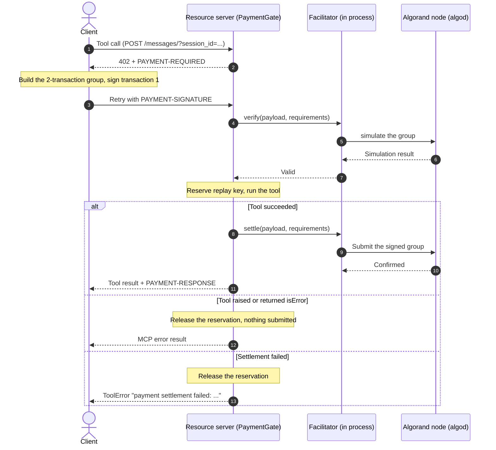

## The x402 flow

[x402](https://www.x402.org) uses HTTP status `402 Payment Required` to sell a resource per request. For an MCP server wrapped with `PaymentGate`, a tool call goes through these steps:

1. The client opens the MCP connection (`GET /sse`) and sends a tool call (`POST /messages/?session_id=...`). Opening the SSE stream and listing tools are free.
2. `PaymentGate` intercepts the `tools/call` request, computes the price for that tool, arguments and caller, and answers `402` with a `PAYMENT-REQUIRED` header: the accepted scheme, network, asset, amount, recipient (`payTo`) and fee payer.
3. The client builds and signs a payment that matches the requirement.
4. The client retries the call with a `PAYMENT-SIGNATURE` header holding the signed transactions.
5. The server verifies the payment, reserves it against replay, runs the tool, settles the payment on chain if the tool succeeded, and returns the result. A `PAYMENT-RESPONSE` header carries the settlement result.

A tool whose price is 0 (free, or covered by a [pass](#passes)) is passed through without a challenge.



In `ai-economy-sdk` the facilitator runs in the same process as the resource server: `PaymentGate` creates an `x402Facilitator` and registers the Algorand scheme with your signer. With `x402-algorand` you can also run the facilitator separately. See [Facilitator](/x402-algorand/facilitator).

## The two-transaction atomic group

When the server sponsors fees (it advertises `extra.feePayer` in the requirement, which `PaymentGate` always does), the payment is an [atomic group](/glossary#atomic-group) of two transactions:

| Index | Type | Sender | Receiver | Amount | Fee | Signed by |
|---|---|---|---|---|---|---|
| 0 | `pay` | Fee payer | Fee payer | 0 | 2,000 microALGO | Server (fee payer) |
| 1 | `pay` (ALGO) or `axfer` (ASA) | Buyer | `payTo` | The price | 0 | Buyer |

Algorand pools fees within a group. The minimum fee is 1,000 microALGO per transaction, so a two-transaction group needs 2,000 microALGO in total. Transaction 0 pays all of it, and transaction 1 has a fee of 0. The buyer's balance drops by exactly the price, even when the price is in USDC.

The client signs only transaction 1. The server signs transaction 0 at settlement. Because the group is atomic, the server cannot submit its own transaction without the buyer's payment, and the payment cannot go through without the server's fee transaction.

Without a fee payer, the payment is a single transaction signed by the buyer, who pays the normal 1,000 microALGO fee.

<Note>
  Prices in ALGO must cover the 2,000 microALGO the server pays per settled call. `PaymentGate` refuses a fixed ALGO price in `(0, 2000]` unless you pass `allow_loss=True`. See [Pricing](/ai-economy-sdk/pricing#the-fee-floor).
</Note>

## Settle-on-success

Many payment flows charge first and refund on failure. `PaymentGate` does it the other way round:

1. **Verify.** The facilitator checks the group against the requirement (scheme, network, recipient, asset, exact amount, group id, signature, fee payer rules) and simulates the group on algod with `allow_empty_signatures=True`. Simulation checks balances and validity without broadcasting.
2. **Run the tool.** The signed group is held while the tool runs.
3. **On failure, discard.** If the tool raises or returns an MCP error result (`isError`), the server releases the replay reservation and never submits the group. The buyer is not charged.
4. **On success, settle.** The server signs the fee payer transaction, submits the group and waits for confirmation. If submission fails (for example the transactions expired), the client receives `ToolError("payment settlement failed: <reason>")` instead of the result.
5. **Respond.** After settlement the replay entry is committed and the tool result is returned.

The example [localnet/failed_call_not_charged.py](/ai-economy-sdk/settlement) shows a failing tool and a balance drop of 0.

## Identity proofs

A caller can prove which Algorand address it controls without paying. Servers use the address for [passes](#passes), subscriptions, bulk discounts and per-caller prices. Two formats are accepted by `verify_identity`:

- **`X-Identity-Txn` (recommended).** A signed Algorand payment transaction that can never execute: sender and receiver are the caller, amount 0, fee 0, and the note is `x402-identity:<address>:<unix timestamp>`. It is bound to one network by its genesis hash. Browser wallets can sign it because it is an ordinary transaction. Build it with `sign_identity_txn` (Python) or `buildIdentityTxn` (JavaScript).
- **Legacy `x-sender-*` headers.** `x-sender-address`, `x-sender-timestamp` and `x-sender-signature`, an Ed25519 signature over `x402-identity:<address>:<timestamp>`. `paid_mcp_session` sends these on every request when `identity=True` (the default).

The verifier rejects proofs whose timestamp is more than 120 seconds from the server's clock. The transaction form also cannot be replayed on chain: its fee is below the network minimum and `make_identity_txn` sets its validity to rounds 1 to 1000, which every live network has passed. Details: [Identity](/ai-economy-sdk/identity).

## Passes

A pass gives a buyer free calls for a period (30 days by default) after a single on-chain purchase. A pass is an ordinary payment from the buyer to the vendor's `pay_to` address with the note:

```text
x402-pass:<scope>
```

for example `x402-pass:listing:echo-1` or `x402-pass:vendor:acme-corp`. A gate configured with `pass_scopes={scope: price}` looks up the caller's recent payments on the indexer. If it finds an unexpired pass payment for one of its scopes of at least that scope's price, the call's price becomes 0 and no challenge is sent. Positive lookups are cached for 20 seconds. The caller is identified by its identity proof. Details: [Passes](/ai-economy-sdk/passes).

## Replay protection

A signed `PAYMENT-SIGNATURE` must pay for one call only. `PaymentGate` hashes the payment payload with SHA-256 and keeps the hash in a replay store:

- `reserve` before the tool runs. If the hash is already reserved or settled, the request is rejected with `402` and `{"error": "Replay detected"}`, and the tool does not run.
- `commit` after settlement succeeds.
- `release` when the tool fails or settlement fails, so the buyer can retry with a fresh payment.

The default store is in memory, which protects a single process. With several worker processes, pass `replay_db="/path/replay.db"` so all workers share one SQLite database (WAL mode). See [Settlement](/ai-economy-sdk/settlement#replay-protection).

## Network binding

Every Algorand transaction carries the genesis hash of its network. The client refuses to build a payment when its algod is on a different network from the requirement, and the facilitator rejects a group whose genesis hash does not match the requirement's network (`invalid_exact_avm_payload_genesis_hash_mismatch`). A payment signed on TestNet cannot be used on MainNet. Network ids are described on [Networks](/networks).
