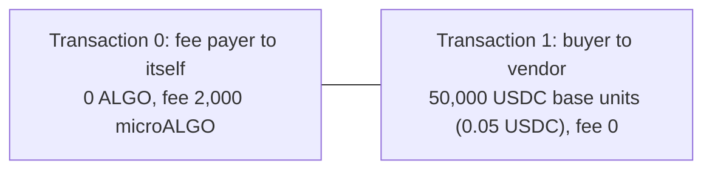

You will configure a paid service to charge in USDC on Algorand MainNet (or TestNet), make sure both sides can hold the asset, and check payments against live network state without spending anything.

## Asset ids

| Network | CAIP-2 id | USDC asset id | Decimals |
|---|---|---|---|
| MainNet | `algorand:wGHE2Pwdvd7S12BL5FaOP20EGYesN73k` | `31566704` | 6 |
| TestNet | `algorand:SGO1GKSzyE7IEPItTxCByw9x8FmnrCDe` | `10458941` | 6 |
| LocalNet | derived from algod | none (use ALGO or your own ASA) | |

`usdc_asset_id(network)` (Python) and `MAINNET.usdc` / `TESTNET.usdc` (JavaScript) return these ids.

Amounts are integers in base units:

| USDC | Base units |
|---|---|
| 1.00 | `1000000` |
| 0.10 | `100000` |
| 0.01 | `10000` |
| 0.005 | `5000` |

## Step 1: Opt in

An Algorand account must opt in to an ASA before it can receive it. Both the vendor's `pay_to` account and every buyer need to opt in to USDC. An opt-in is a 0-amount transfer of the asset to yourself:

```python
from algosdk.transaction import AssetTransferTxn, wait_for_confirmation
from algosdk.v2client import algod

def opt_in_usdc(client: algod.AlgodClient, address: str, private_key: str, usdc_asset_id: int) -> None:
    params = client.suggested_params()
    txn = AssetTransferTxn(sender=address, sp=params, receiver=address, amt=0, index=usdc_asset_id)
    txid = client.send_transaction(txn.sign(private_key))
    wait_for_confirmation(client, txid, 4)
```

Each opt-in raises the account's minimum balance by 0.1 ALGO (from 0.1 ALGO to 0.2 ALGO for one asset), so the account needs that much ALGO first.

If either side has not opted in, the facilitator's simulation fails and the payment is refused with `transaction_simulation_failed`. The node's message, in `invalid_message`, says which account is missing the asset.

## Step 2: Understand who pays the fee

Network fees on Algorand are always paid in ALGO, even for an ASA transfer. In the x402 group the vendor's fee payer covers them:



- The buyer spends only USDC.
- The vendor's fee payer spends 2,000 microALGO per settled call; 10 ALGO covers 5,000 calls.

Keep ALGO in the fee payer account. When it runs out, settlement fails and callers are not charged, but they also get no result.

## Step 3: Configure the server

```python
import os
from algosdk.v2client import algod
from ai_economy_sdk import MAINNET, DefaultAvmSigner, PaymentGate, usdc_asset_id

client = algod.AlgodClient("", "https://mainnet-api.algonode.cloud")
signer = DefaultAvmSigner(os.environ["FEE_PAYER_PRIVATE_KEY"], algod_client=client)

gate = PaymentGate(
    signer=signer,
    network=MAINNET,
    pay_to=os.environ["VENDOR_ADDRESS"],
    asset_id=usdc_asset_id(MAINNET),  # 31566704
    default_price=50_000,             # 0.05 USDC per call
)
```

The fee floor that rejects low ALGO prices does not apply when `asset_id` is not 0: USDC prices are not compared with ALGO fees.

For an HTTP API with `x402-algorand`, use the asset in the route price: `{"amount": "50000", "asset": "31566704"}`.

## Step 4: Clients

`paid_mcp_session` and `x402Client` allow MainNet and TestNet USDC by default, up to 1 USDC (1,000,000 base units) per payment. Raise the cap with `spend_controls={"max_amount_per_payment": "$5"}` if your prices are higher. See [Guardrails](/agents/guardrails).

## Step 5: Test against live state without funds

Algod's simulate endpoint evaluates a group against the current ledger without committing it, and can skip signatures. The examples repository uses it to check ALGO and USDC payment groups, with and without a fee payer. The scripts find real funded USDC holders through the public indexer, so they need no keys and spend nothing.

| Network | Python | JavaScript |
|---|---|---|
| TestNet | [`testnet/simulate.py`](https://github.com/x402-avm/examples/blob/main/testnet/simulate.py) | [`testnet/simulate.mjs`](https://github.com/x402-avm/examples/blob/main/testnet/simulate.mjs) |
| MainNet | [`mainnet/simulate.py`](https://github.com/x402-avm/examples/blob/main/mainnet/simulate.py) | [`mainnet/simulate.mjs`](https://github.com/x402-avm/examples/blob/main/mainnet/simulate.mjs) |

They are shown in full in the [TestNet](/guides/networks/testnet#check-payments-without-funds) and [MainNet](/guides/networks/mainnet#simulate-on-mainnet) guides. The package test suites run the same kind of checks with `PUBLIC_NETS=1`. For a real payment on TestNet, see [`testnet/live_payment.py`](/guides/networks/testnet#a-real-testnet-payment).

## Next steps

- [From LocalNet to MainNet](/tutorials/localnet-to-mainnet)
- [MainNet guide](/guides/networks/mainnet)
- [Troubleshooting](/resources/troubleshooting)
